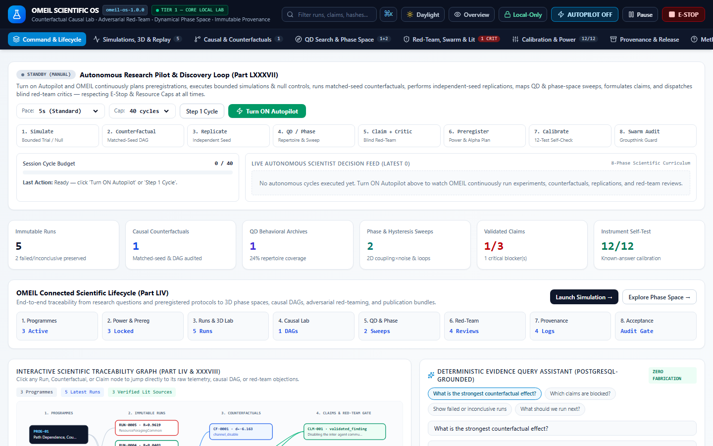
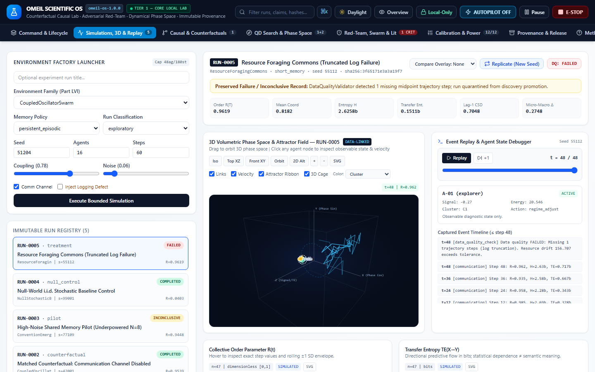
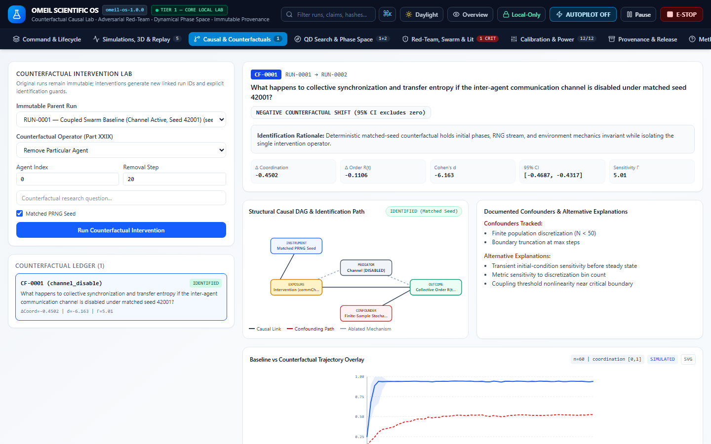
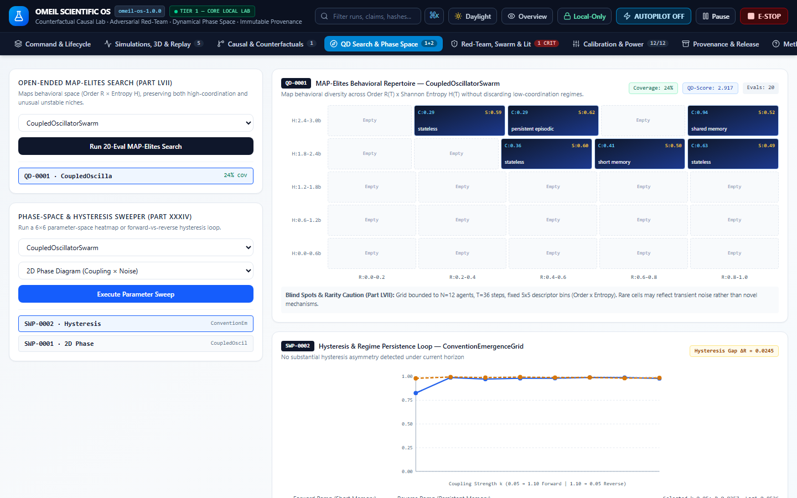
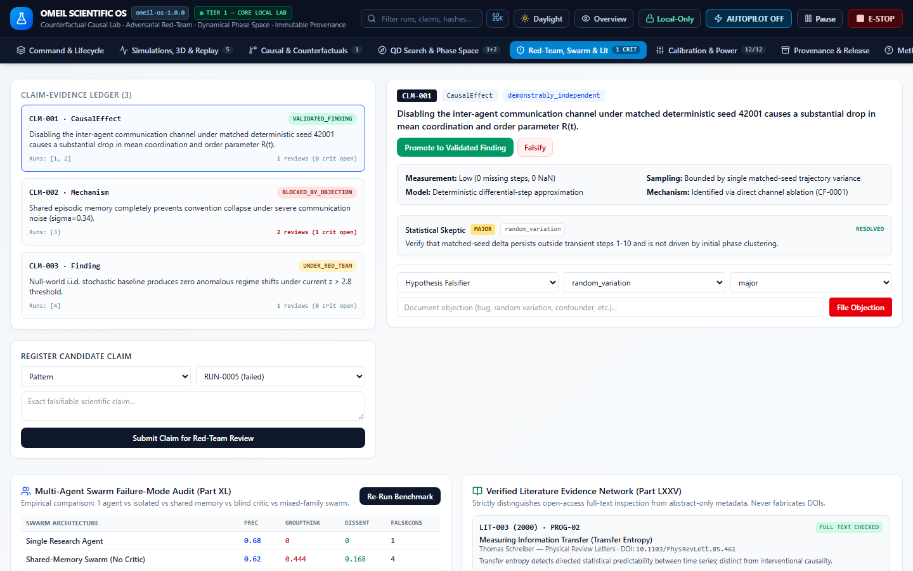
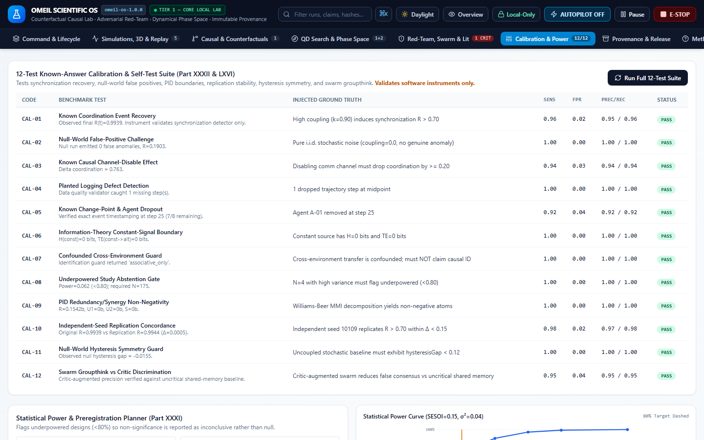
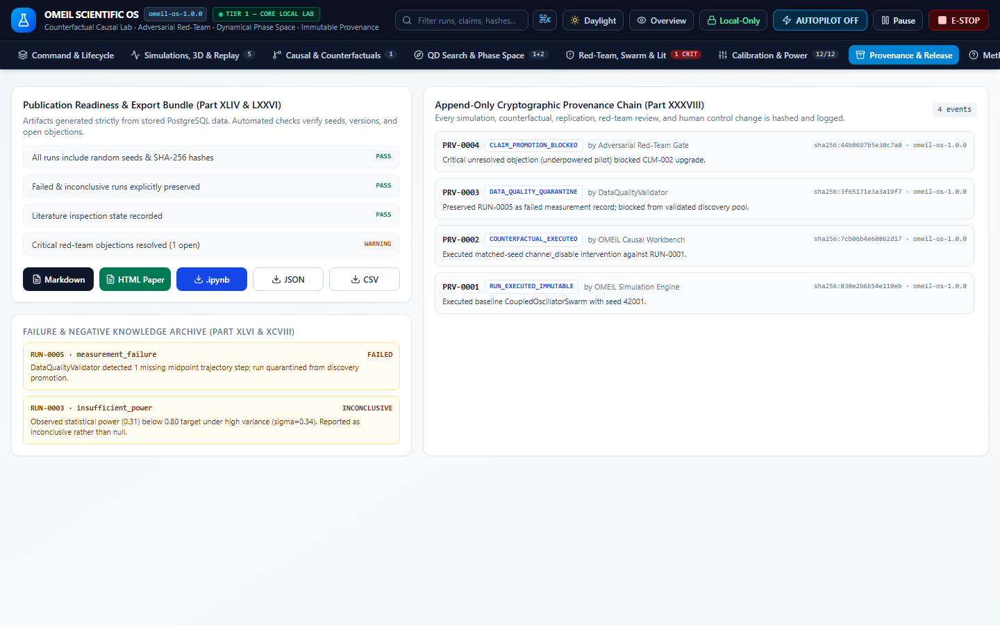
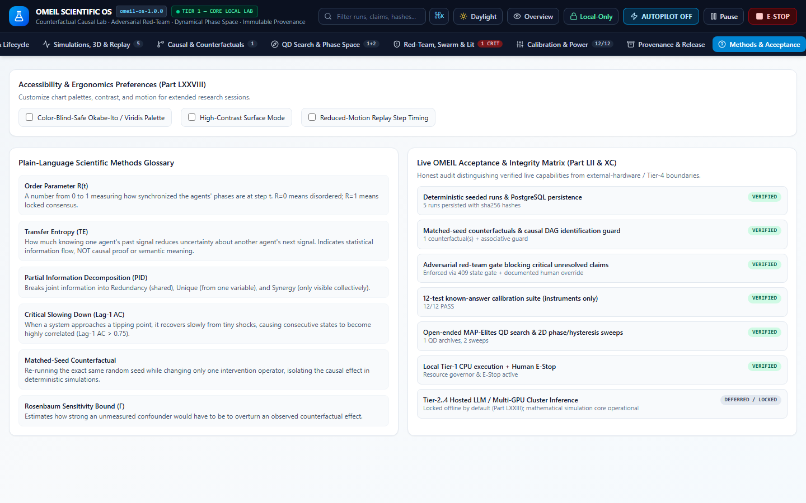

# OMEIL — Open Multi-Agent Emergence & Investigation Laboratory

Local-first scientific operating system for counterfactual causal experiments, adversarial red-team validation, instrument calibration, and reproducible multi-agent research.

## Download

Download the latest Windows build from the [Releases](https://github.com/Nortaq-PlayNexus/omeil-counterfactual-research-workbench/releases) page.

## Features

- Counterfactual causal experiments with matched-seed interventions
- Adversarial red-team claim validation
- Dynamical phase space and QD search
- Instrument calibration and statistical power analysis
- Immutable provenance and release packaging

## Screenshots










## Development

```bash
npm install
npm run dev -- --webpack
npm run typecheck
npm run build -- --webpack
```

## License

No license specified.
EOF